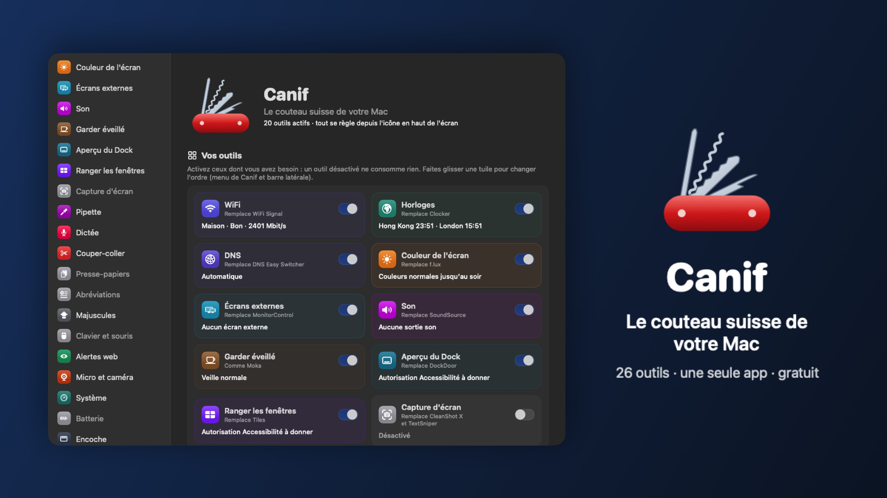

<h1 align="center">Canif</h1>

<b>Le couteau suisse de votre Mac : 26 outils dans une seule app, gratuite, en 7 langues.</b> 
Your Mac's Swiss army knife: 26 tools in one free app, in 7 languages.

<a href="https://github.com/xavier38/canif/releases/latest/download/Canif.zip"><b>⬇︎ Télécharger / Download Canif.zip</b></a> ·
<a href="https://xavier38.github.io/canif/">Site</a> ·
<a href="https://xavier38.github.io/canif/installation.html">Installation</a> ·
<a href="https://xavier38.github.io/canif/confidentialite.html">Confidentialité / Privacy</a>

Version 0.4.0 · Mac Apple Silicon, macOS 14 ou plus récent · Apple Silicon Mac, macOS 14 or later

## 🇫🇷 Les 26 outils

| Outil | Ce qu'il fait |
|---|---|
| 📶 **WiFi** | La qualité de votre WiFi en un coup d'œil, avec le signal en direct. |
| 🌍 **Horloges** | L'heure de vos villes préférées dans la barre des menus. |
| 🌐 **DNS** | Changez de DNS en un clic : plus rapide, plus sûr, sans pub. |
| ☀️ **Couleur de l'écran** | Moins de lumière bleue le soir, avec horaires et transition douce. |
| ☕️ **Garder éveillé** | Empêchez le Mac de s'endormir, le temps qu'il faut. |
| 🪟 **Aperçu du Dock** | Survolez une icône du Dock pour voir ses fenêtres, la musique en cours (Musique, Spotify) ou un dossier. Aussi avec ⌘⇥, boutons sur les vignettes, gestes de défilement et indicateur d'app active. |
| ▦ **Ranger les fenêtres** | Glissez une fenêtre contre un bord, ou ⌃⌥ + flèche. |
| 🎙️ **Dictée** | Maintenez un raccourci et parlez : le texte s'écrit tout seul, sans internet. Modèle au choix comme dans Handy (Parakeet Ultra/V3/V2, Canary, Whisper Small/Medium/Turbo/Large, SenseVoice), retouche par IA facultative. |
| ✂️ **Couper-coller** | ⌘X puis ⌘V pour déplacer des fichiers dans le Finder. |
| ⇪ **Majuscules** | Voyez tout de suite quand le verrouillage des majuscules est activé. |
| 🔔 **Alertes web** | Soyez prévenu quand une partie d'une page web change. |
| 🔴 **Micro et caméra** | Un badge (message et son au choix) s'affiche dès qu'une app allume votre micro ou votre caméra. |
| 📊 **Système** | Comme Stats : processeur (cœurs performance/efficaces), carte graphique, mémoire (historique, top 10 par catégorie), disques (volumes, activité et carte de ce qui prend de la place, comme GrandPerspective), réseau, températures, consommation, batterie (cycles, santé). Mesures au choix dans la barre des menus. |
| ⬛️ **Encoche** | Comme NotchNook : une île dynamique sous l'encoche (musique de n'importe quelle app, agenda avec bouton « Rejoindre » et alerte avant les réunions, widget Raccourcis, appareils Bluetooth, miroir, note), HUD de volume et de luminosité, gestes, plateau de fichiers à glisser (AirDrop, Coup d'œil), activités en direct (morceau en cours, charge, prochain rendez-vous, volume) et un parcours guidé pour les autorisations. |
| 🌐 **Apps web** | Comme WebCatalog : transformez un site en vraie app Mac légère, avec sa propre session, ses notifications, sa pastille et son icône ; import des apps WebCatalog. |
| 📋 **Presse-papiers** | Comme Maccy : retrouvez tout ce que vous avez copié, et collez-le d'un raccourci (⇧⌘V). Recherche, épingles ; ignore les gestionnaires de mots de passe. |
| ⌨️ **Abréviations** | Comme TextExpander : tapez quelques lettres, Canif écrit le reste. Variables {date}, {heure}, {presse-papiers}, {curseur}. |
| 〉 **Barre des menus** | Comme Bartender, Ice et Hidden Bar : rangez les icônes de la barre des menus derrière un chevron. |
| 📸 **Capture d'écran** | Comme CleanShot X et TextSniper : zone, fenêtre, page entière, texte (OCR), QR codes ; capturez, annotez, épinglez, partagez. |
| 🎨 **Pipette** | Comme ColorSlurp : prenez la couleur de n'importe quel pixel, dans le format voulu (HEX, RGB, HSL, SwiftUI…), avec le contraste WCAG. |
| 🔊 **Son** | Comme SoundSource : changez de sortie en un clic, volume par app (0–150 %) et sortie par app, égaliseur 10 bandes (bêta). |
| 🖥️ **Écrans externes** | Comme MonitorControl : réglez la luminosité et le volume de vos écrans externes, comme celui du Mac. |
| 🔋 **Batterie** | Comme AlDente : limitez la charge de la batterie pour qu'elle dure des années. Assistant installé avec le mot de passe administrateur ; méthode de secours selon les Mac. |
| 🗑️ **Désinstaller** | Comme AppCleaner : désinstallez une app et tous ses fichiers cachés, en un geste. |
| 🖱️ **Clavier et souris** | Comme Mos et SlowQuit : molette douce, sens de défilement séparé, ⌘Q protégé et nettoyage du clavier. |
| 🍅 **Pomodoro** | Comme Session et Be Focused : travaillez par séances de 25 minutes, avec de vraies pauses. |

Chaque outil s'active ou se coupe d'un clic, se règle en mode standard ou expert, et se commande depuis l'icône en haut de l'écran. Sons de notification au choix pour tous les outils. Les icônes des outils se placent juste à côté de celle de Canif.

**Nouveau dans la 0.4.0 :** 11 nouveaux outils, Encoche complète, nouvelles couleurs du WiFi, beaucoup moins de processeur au repos (environ 5 % → moins de 1 %), sécurité renforcée (hardened runtime, validation des DNS saisis, liens et téléchargements plus sûrs dans les apps web).

## 🇬🇧 The 26 tools

| Tool | What it does |
|---|---|
| 📶 **WiFi** | Your WiFi quality at a glance, with the live signal. |
| 🌍 **Clocks** | The time in your favourite cities, in the menu bar. |
| 🌐 **DNS** | Switch DNS in one click: faster, safer, ad-free. |
| ☀️ **Screen colour** | Less blue light in the evening, with schedules and a smooth transition. |
| ☕️ **Keep awake** | Keep your Mac from going to sleep, for as long as you need. |
| 🪟 **Dock preview** | Hover over a Dock icon to see its windows, the music playing (Music, Spotify) or a folder. Also with ⌘⇥, thumbnail buttons, scroll gestures and an active-app indicator. |
| ▦ **Window snapping** | Drag a window to an edge of the screen, or press ⌃⌥ + arrow. |
| 🎙️ **Dictation** | Hold down a shortcut and speak: the text types itself, no internet needed. Choose your model as in Handy (Parakeet Ultra/V3/V2, Canary, Whisper Small/Medium/Turbo/Large, SenseVoice), optional AI touch-up. |
| ✂️ **Cut and paste** | ⌘X then ⌘V to move files in the Finder. |
| ⇪ **Caps Lock** | See right away when Caps Lock is on. |
| 🔔 **Web alerts** | Get notified when part of a web page changes. |
| 🔴 **Microphone and camera** | A badge (custom message and sound) appears as soon as an app turns on your microphone or camera. |
| 📊 **System** | Like Stats: CPU (performance/efficiency cores), GPU, memory (history, top 10 per category), disks (volumes, activity and a map of what takes up space, like GrandPerspective), network, temperatures, power, battery (cycles, health). Pick what shows in the menu bar. |
| ⬛️ **Notch** | Like NotchNook: a dynamic island under the notch (music from any app, calendar with a “Join” button and meeting alerts, Shortcuts widget, Bluetooth devices, mirror, notes), volume and brightness HUD, gestures, a file tray to drag into (AirDrop, Quick Look), live activities (now playing, charging, next event, volume) and a guided permissions journey. |
| 🌐 **Web apps** | Like WebCatalog: turn a website into a light, real Mac app with its own session, notifications, badge and icon; imports your WebCatalog apps. |
| 📋 **Clipboard** | Like Maccy: find everything you copied and paste it with a shortcut (⇧⌘V). Search, pins; password managers are ignored. |
| ⌨️ **Abbreviations** | Like TextExpander: type a few letters, Canif writes the rest. {date}, {time}, {clipboard} and {cursor} placeholders. |
| 〉 **Menu bar** | Like Bartender, Ice and Hidden Bar: tuck menu bar icons away behind a chevron. |
| 📸 **Screenshot** | Like CleanShot X and TextSniper: area, window, full page, text (OCR), QR codes; capture, annotate, pin, share. |
| 🎨 **Colour picker** | Like ColorSlurp: grab the colour of any pixel, in the format you need (HEX, RGB, HSL, SwiftUI…), with WCAG contrast. |
| 🔊 **Sound** | Like SoundSource: switch outputs in one click, per-app volume (0–150%) and per-app output, 10-band equaliser (beta). |
| 🖥️ **External displays** | Like MonitorControl: set the brightness and volume of your external displays, just like the Mac's. |
| 🔋 **Battery** | Like AlDente: limit battery charging so it lasts for years. Helper installed with your administrator password; fallback method on some Macs. |
| 🗑️ **Uninstall** | Like AppCleaner: uninstall an app and all its hidden files in one go. |
| 🖱️ **Keyboard and mouse** | Like Mos and SlowQuit: smooth scroll wheel, separate scroll directions, protected ⌘Q and keyboard cleaning. |
| 🍅 **Pomodoro** | Like Session and Be Focused: work in 25-minute sessions, with real breaks. |

Each tool turns on or off with one click, has standard and expert settings, and is controlled from the icon at the top of the screen. The tools' icons sit right next to Canif's.

**New in 0.4.0:** 11 new tools, a full-featured Notch, new WiFi colours, far less CPU at idle (about 5% → under 1%), security hardening (hardened runtime, DNS input validation, safer links and downloads in web apps).

## 🌍 Other languages

- 🇪🇸 La navaja suiza de su Mac: 26 herramientas en una sola app, en 7 idiomas. → [Sitio](https://xavier38.github.io/canif/)
- 🇧🇷 O canivete suíço do seu Mac: 26 ferramentas em um só app, em 7 idiomas. → [Site](https://xavier38.github.io/canif/)
- 🇳🇱 Het Zwitserse zakmes van uw Mac: 26 tools in één app, in 7 talen. → [Website](https://xavier38.github.io/canif/)
- 🇩🇪 Das Schweizer Taschenmesser für Ihren Mac: 26 Werkzeuge in einer App, in 7 Sprachen. → [Website](https://xavier38.github.io/canif/)
- 🇮🇹 Il coltellino svizzero del tuo Mac: 26 strumenti in un'unica app, in 7 lingue. → [Sito](https://xavier38.github.io/canif/)

Langues de l'app / App languages: Français, English, Español, Português (Brasil), Nederlands, Deutsch, Italiano.

## Confidentialité / Privacy

Tout reste sur votre Mac. Statistiques d'usage anonymes **désactivées par défaut** (opt-in). · Everything stays on your Mac. Anonymous usage statistics are **off by default** (opt-in).

[☕️ Offrir un café / Buy me a coffee](https://xavier38.github.io/canif/cafe.html)
