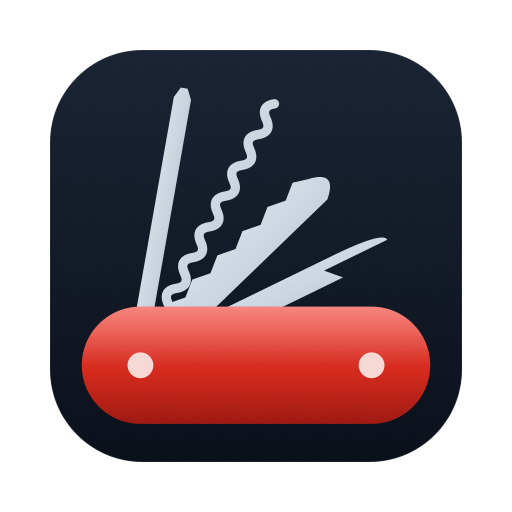

<h1 align="center">Canif</h1>

<b>Le couteau suisse de votre Mac : 34 outils dans une seule app, gratuite, en 7 langues. Moka est inclus.</b> 
Your Mac's Swiss army knife: 34 tools in one free app, in 7 languages. Moka is included.

<a href="https://github.com/xavier38/canif/releases/latest/download/Canif.zip"><b>⬇︎ Télécharger / Download Canif.zip</b></a> ·
<a href="https://xavier38.github.io/canif/">Site</a> ·
<a href="https://xavier38.github.io/canif/installation.html">Installation</a> ·
<a href="https://xavier38.github.io/canif/confidentialite.html">Confidentialité / Privacy</a>

Version 1.7.0 · Mac Apple Silicon, macOS 14 ou plus récent · Apple Silicon Mac, macOS 14 or later

## Nouveautés 1.7.0 / What’s new

Réglages selon le réseau WiFi (DNS, volume, son, Garder éveillé), outils masquables du menu. Canif est désormais réservé au Mac. Settings by Wi‑Fi network (DNS, volume, sound, Keep awake), tools can be hidden from the menu. Canif is now Mac only.

## Nouveautés 1.5.0

Nouveaux outils Calendrier et Renommer ; test de débit dans WiFi ; mise en veille programmée ; assombrir autour de la fenêtre en Concentration ; collections du presse-papiers. New Calendar and Rename tools; speed test in Wi‑Fi; sleep timer; dim around the active window in Focus; clipboard collections.

## Nouveautés 1.3.2

Nouveaux outils Antivol, Niveau à bulle et Modding divers (porte qui grince, clavier en musique, morse) ; signaux sur le Mac (vibration du trackpad, voyant ⇪, flash du clavier) pour chaque outil qui prévient ; annonces vocales en option ; LED du MagSafe au choix. New Anti-theft, Spirit level and Mods tools (creaking lid, keyboard that pulses with music, Morse); signals on the Mac (trackpad vibration, ⇪ light, keyboard flash) for every tool that alerts you; optional spoken announcements; choose your MagSafe LED.

## 🇫🇷 Les 34 outils

| Outil | Ce qu'il fait |
|---|---|
| 🌐 **Appareils du réseau** | Appareils connectés, adresses MAC affichables, noms personnalisés importés, pièces et personnes, tri par nom/IP/MAC croissant ou décroissant, surveillance et réveil à distance. |
| 📶 **WiFi** | La qualité de votre WiFi en un coup d'œil, avec le signal en direct. |
| 🌍 **Horloges** | L'heure de vos villes préférées dans la barre des menus. |
| 🌐 **DNS** | Changez de DNS en un clic : plus rapide, plus sûr, sans pub. |
| ☀️ **Couleur de l'écran** | Moins de lumière bleue le soir, avec horaires et transition douce. |
| ☕️ **Garder éveillé** | Empêchez le Mac de s'endormir, le temps qu'il faut. C'est l'app [Moka](https://xavier38.github.io/moka/), intégrée à Canif. |
| 🪟 **Aperçu du Dock** | Survolez une icône du Dock pour voir ses fenêtres, la musique en cours (Musique, Spotify) ou un dossier. Aussi avec ⌘⇥, boutons sur les vignettes, gestes de défilement et indicateur d'app active. |
| ▦ **Ranger les fenêtres** | Glissez une fenêtre contre un bord, ou ⌃⌥ + flèche. |
| 🎙️ **Dictée** | Maintenez un raccourci et parlez : le texte s'écrit tout seul, sans internet. Modèle au choix (Parakeet Ultra/V3/V2, Canary, Whisper Small/Medium/Turbo/Large, SenseVoice), retouche par IA facultative. |
| ✂️ **Couper-coller** | ⌘X puis ⌘V pour déplacer des fichiers dans le Finder. Son au choix pour ⌘X, ⌘C et ⌘V, flash de couleur à l’écran. |
| ⇪ **Majuscules** | Voyez tout de suite quand le verrouillage des majuscules est activé. |
| 🔔 **Alertes web** | Soyez prévenu quand une partie d'une page web change. Annonce vocale en option. |
| 🔴 **Micro et caméra** | Un badge (message et son au choix) s'affiche dès qu'une app allume votre micro ou votre caméra. |
| 📊 **Système** | Processeur (cœurs performance/efficaces), carte graphique, mémoire (historique, top 10 par catégorie), disques (volumes, activité et carte de ce qui prend de la place), réseau, températures, consommation, batterie (cycles, santé). Mesures au choix dans la barre des menus. |
| ⬛️ **Encoche** | Cartes colorées pour la musique, l’agenda, le son, l’éveil, le suivi micro/caméra, les horloges, le WiFi détaillé, le système, les alertes web, la concentration, la batterie, les fichiers et les notes. Commandes rapides de capture, pipette et rangement des fenêtres. |
| 🌐 **Apps web** | Transformez un site en vraie app Mac légère, avec sa propre session, ses notifications, sa pastille et son icône. |
| 📋 **Presse-papiers** | Retrouvez tout ce que vous avez copié, et collez-le d'un raccourci (⇧⌘V). Recherche, épingles ; ignore les gestionnaires de mots de passe. |
| ⌨️ **Abréviations** | Tapez quelques lettres, Canif écrit le reste. Variables {date}, {heure}, {presse-papiers}, {curseur}. |
| 〉 **Barre des menus** | Rangez les icônes de la barre des menus derrière un chevron. |
| 📸 **Capture d'écran** | Zone, fenêtre, page entière, texte (OCR), QR codes ; capturez, annotez, épinglez, partagez. |
| 🎨 **Pipette** | Prenez la couleur de n'importe quel pixel, dans le format voulu (HEX, RGB, HSL, SwiftUI…), avec le contraste WCAG. |
| 🔊 **Son** | Changez de sortie en un clic, volume par app (0–150 %) et sortie par app, égaliseur 10 bandes (bêta). |
| 🖥️ **Écrans externes** | Réglez la luminosité et le volume de vos écrans externes, comme celui du Mac. |
| 🔋 **Batterie** | Limitez la charge de la batterie pour qu'elle dure des années. Assistant installé avec le mot de passe administrateur ; méthode de secours selon les Mac. LED du MagSafe au choix, annonce vocale en option. |
| 🗑️ **Désinstaller** | Désinstallez une app et tous ses fichiers cachés, en un geste. |
| 🖱️ **Clavier et souris** | Comme Mos et SlowQuit : molette douce, sens de défilement séparé, ⌘Q protégé et nettoyage du clavier. |
| ⏱️ **Concentration** | Travaillez par séances de 25 minutes, avec de vraies pauses. |
| 🗒️ **Aide-mémoire** | Des notes autocollantes sur le bureau, enregistrées toutes seules (remplace l'Aide-mémoire de macOS). |
| 🪄 **Modding divers** | L’écran grince comme une vieille porte quand vous l’ouvrez, le clavier pulse avec la musique, et le voyant ⇪ parle en morse. |
| 🚨 **Antivol** | Armez-le en partant : si quelqu’un bouge le Mac, débranche le chargeur ou referme l’écran, une sirène retentit jusqu’au déverrouillage. |
| 📅 **Calendrier** | La date dans la barre des menus ; un clic montre le mois et vos rendez-vous. |
| 🔤 **Renommer** | Renommez des dizaines de fichiers d’un coup, avec aperçu et annulation. |
| 🫧 **Niveau à bulle** | L’accéléromètre caché du Mac dit si une surface est horizontale, au dixième de degré. |

Chaque outil s'active ou se coupe d'un clic, se règle en mode standard ou expert, et se commande depuis l'icône en haut de l'écran. Sons de notification au choix pour tous les outils. Les icônes des outils se placent juste à côté de celle de Canif.

**Nouveau dans la 0.4.0 :** 11 nouveaux outils, Encoche complète, nouvelles couleurs du WiFi, beaucoup moins de processeur au repos (environ 5 % → moins de 1 %), sécurité renforcée (hardened runtime, validation des DNS saisis, liens et téléchargements plus sûrs dans les apps web).

## 🇬🇧 The 34 tools

| Tool | What it does |
|---|---|
| 🌐 **Network devices** | Connected devices, optional MAC addresses in the list, imported custom names, rooms and people, ascending or descending name/IP/MAC sorting, monitoring and Wake-on-LAN. |
| 📶 **WiFi** | Your WiFi quality at a glance, with the live signal. |
| 🌍 **Clocks** | The time in your favourite cities, in the menu bar. |
| 🌐 **DNS** | Switch DNS in one click: faster, safer, ad-free. |
| ☀️ **Screen colour** | Less blue light in the evening, with schedules and a smooth transition. |
| ☕️ **Keep awake** | Keep your Mac from going to sleep, for as long as you need. It's the [Moka](https://xavier38.github.io/moka/) app, built into Canif. |
| 🪟 **Dock preview** | Hover over a Dock icon to see its windows, the music playing (Music, Spotify) or a folder. Also with ⌘⇥, thumbnail buttons, scroll gestures and an active-app indicator. |
| ▦ **Window snapping** | Drag a window to an edge of the screen, or press ⌃⌥ + arrow. |
| 🎙️ **Dictation** | Hold down a shortcut and speak: the text types itself, no internet needed. Choose your model (Parakeet Ultra/V3/V2, Canary, Whisper Small/Medium/Turbo/Large, SenseVoice), optional AI touch-up. |
| ✂️ **Cut and paste** | ⌘X then ⌘V to move files in the Finder. Pick a sound for ⌘X, ⌘C and ⌘V, on-screen colour flash. |
| ⇪ **Caps Lock** | See right away when Caps Lock is on. |
| 🔔 **Web alerts** | Get notified when part of a web page changes. Optional spoken alert. |
| 🔴 **Microphone and camera** | A badge (custom message and sound) appears as soon as an app turns on your microphone or camera. |
| 📊 **System** | CPU (performance/efficiency cores), GPU, memory (history, top 10 per category), disks (volumes, activity and a map of what takes up space), network, temperatures, power, battery (cycles, health). Pick what shows in the menu bar. |
| ⬛️ **Notch** | Coloured cards for music, calendar, sound, keep awake, microphone/camera monitoring, clocks, detailed WiFi, system, web alerts, focus, battery, files and notes. Quick capture, colour picker and window arrangement actions. |
| 🌐 **Web apps** | Turn a website into a light, real Mac app with its own session, notifications, badge and icon. |
| 📋 **Clipboard** | Find everything you copied and paste it with a shortcut (⇧⌘V). Search, pins; password managers are ignored. |
| ⌨️ **Abbreviations** | Type a few letters, Canif writes the rest. {date}, {time}, {clipboard} and {cursor} placeholders. |
| 〉 **Menu bar** | Tuck menu bar icons away behind a chevron. |
| 📸 **Screenshot** | Area, window, full page, text (OCR), QR codes; capture, annotate, pin, share. |
| 🎨 **Colour picker** | Grab the colour of any pixel, in the format you need (HEX, RGB, HSL, SwiftUI…), with WCAG contrast. |
| 🔊 **Sound** | Switch outputs in one click, per-app volume (0–150%) and per-app output, 10-band equaliser (beta). |
| 🖥️ **External displays** | Set the brightness and volume of your external displays, just like the Mac's. |
| 🔋 **Battery** | Limit battery charging so it lasts for years. Helper installed with your administrator password; fallback method on some Macs. Choose your MagSafe LED, optional spoken alert. |
| 🗑️ **Uninstall** | Uninstall an app and all its hidden files in one go. |
| 🖱️ **Keyboard and mouse** | Like Mos and SlowQuit: smooth scroll wheel, separate scroll directions, protected ⌘Q and keyboard cleaning. |
| ⏱️ **Focus** | Work in 25-minute sessions, with real breaks. |
| 🗒️ **Stickies** | Sticky notes on your desktop, saved automatically (replaces macOS Stickies). |
| 🪄 **Mods** | The screen creaks like an old door when you open it, the keyboard pulses with music, and the ⇪ light speaks Morse. |
| 🚨 **Anti-theft** | Arm it as you leave: if someone moves the Mac, unplugs the charger or closes the lid, a siren sounds until it is unlocked. |
| 📅 **Calendar** | The date in the menu bar; one click shows the month and your events. |
| 🔤 **Rename** | Rename dozens of files at once, with preview and undo. |
| 🫧 **Spirit level** | The Mac’s hidden accelerometer tells you whether a surface is level, to a tenth of a degree. |

Each tool turns on or off with one click, has standard and expert settings, and is controlled from the icon at the top of the screen. The tools' icons sit right next to Canif's.

**New in 0.4.0:** 11 new tools, a full-featured Notch, new WiFi colours, far less CPU at idle (about 5% → under 1%), security hardening (hardened runtime, DNS input validation, safer links and downloads in web apps).

## 🌍 Other languages

- 🇪🇸 La navaja suiza de su Mac: 34 herramientas en una sola app, en 7 idiomas. → [Sitio](https://xavier38.github.io/canif/)
- 🇧🇷 O canivete suíço do seu Mac: 34 ferramentas em um só app, em 7 idiomas. → [Site](https://xavier38.github.io/canif/)
- 🇳🇱 Het Zwitserse zakmes van uw Mac: 34 tools in één app, in 7 talen. → [Website](https://xavier38.github.io/canif/)
- 🇩🇪 Das Schweizer Taschenmesser für Ihren Mac: 34 Werkzeuge in einer App, in 7 Sprachen. → [Website](https://xavier38.github.io/canif/)
- 🇮🇹 Il coltellino svizzero del tuo Mac: 34 strumenti in un'unica app, in 7 lingue. → [Sito](https://xavier38.github.io/canif/)

Langues de l'app / App languages: Français, English, Español, Português (Brasil), Nederlands, Deutsch, Italiano.

## Confidentialité / Privacy

Tout reste sur votre Mac. Statistiques d'usage anonymes **désactivées par défaut** (opt-in). · Everything stays on your Mac. Anonymous usage statistics are **off by default** (opt-in).

[☕️ Offrir un café / Buy me a coffee](https://xavier38.github.io/canif/cafe.html)

